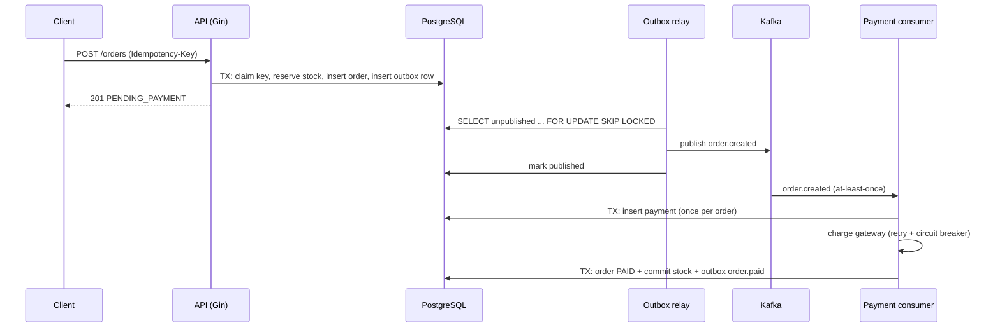

# Architecture

Modular monolith. PostgreSQL is the source of truth; Redis is coordination only; Kafka carries events published through a transactional outbox.

## Decisions

- **Reserve, then commit.** `inventory.reserved` holds stock for pending orders; payment success converts it to a deduction, failure or timeout releases it.
- **One path for terminal transitions.** `cancelPendingOrder` and `markOrderPaid` lock the order row and re-check status, so payment completion and recovery can race safely.
- **Gateway outside transactions.** No DB locks are held during the external call; idempotency comes from keying the charge by payment ID.
- **Late payment compensation.** If a charge succeeds after the order was cancelled, the payment is marked `REFUNDED` and a `payment.refunded` event is emitted.
- **Single topic, keyed by order ID.** Per-order ordering within a partition; consumers filter by `event_type` header.
