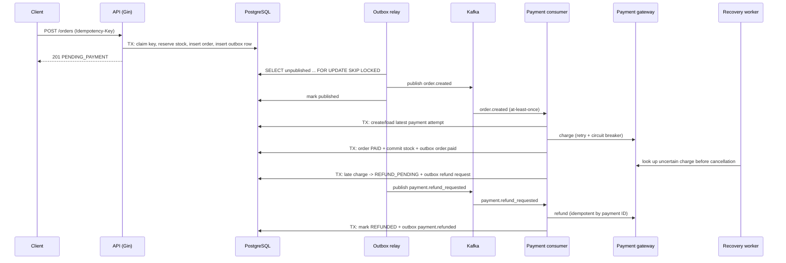

# Architecture

Modular monolith. PostgreSQL is the source of truth; Redis is coordination only; Kafka carries events published through a transactional outbox.

## Decisions

- **Reserve, then commit.** `inventory.reserved` holds stock for pending orders; payment success converts it to a deduction, while timeout cancellation releases it. A declined attempt keeps the order pending for a retry.
- **Payment attempt history.** Every charge uses a distinct row and provider idempotency key. A retry is permitted only after a failed attempt and keeps prior outcomes intact.
- **One path for terminal transitions.** `cancelPendingOrder` and `markOrderPaid` lock the order row and re-check status, so payment completion and recovery can race safely. `SetOrderStatus` validates the domain transition table and records the change in `order_status_history`.
- **Gateway outside transactions.** No DB locks are held during external calls; charge and refund operations are idempotent on payment ID.
- **Late payment compensation.** If a charge succeeds after cancellation, the payment enters `REFUND_PENDING`; a refund request is sent to the gateway and only then transitions to `REFUNDED`. Failed requests are retried by recovery.
- **Unknown charge outcome.** Before cancelling an expired order with a processing payment, recovery marks it `RECONCILING` and queries the gateway. A confirmed charge completes the order, a confirmed decline/absence permits cancellation, and a pending or unavailable lookup leaves the order pending.
- **Single topic, keyed by order ID.** Per-order ordering within a partition; consumers filter by `event_type` header.
